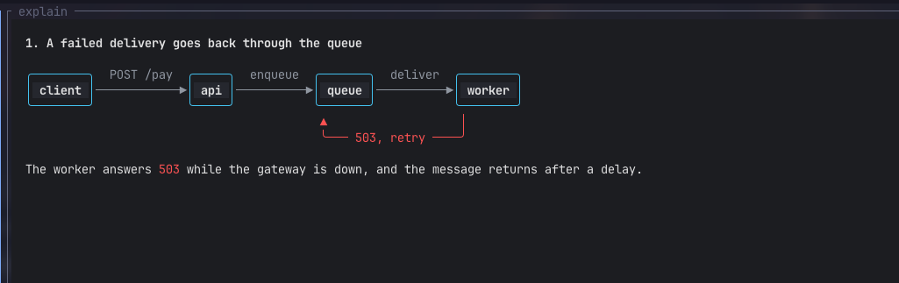
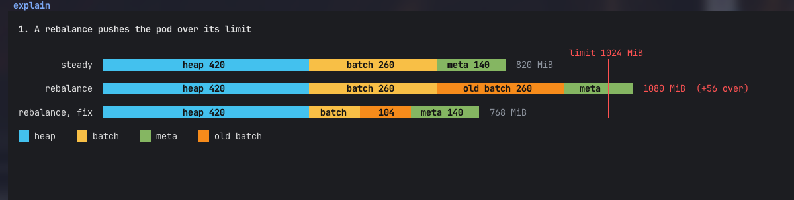

# explain-in-pane

An agent skill that draws explanations in a [herdr](https://herdr.dev) pane next to the conversation: flows, call sequences, trees, bars against a limit, tables, and before and after panels. The agent writes a few lines of Markdown, and the pane draws them to fit its width.

> Inspired by [this tweet](https://x.com/amadeus/status/2120673662156354002).

## Features

- **Markdown in, drawing out.** Boxes and arrows (`flow`), sequence diagrams (`seq`), trees such as dependencies or an AST (`tree`), stacked bars with a limit line (`bars`), panels, tables, lists, footnotes and eleven inline colours. For shapes Markdown cannot express, a page can be a Python drawing ([`textkit`](skills/explain-in-pane/references/textkit.md)).
- **Fits the pane.** Pages are laid out for the pane's width and redrawn on resize: flows turn vertical, trees turn from boxes top down to boxes left to right and only then become text, panels stack, tables become records. Each page is checked at 80, 120 and 200 columns first, and a cut label or an error comes back naming the line.
- **Stays browsable.** Pages stay until the pane is closed, with nvim keys and the mouse to browse them. The same `# Title` replaces a page in place. Each agent session gets its own pane, opened beside it without taking focus.
- **The agent draws on its own** when an answer has several moving parts, and answers in text for short answers. You can also ask: "explain it in the pane".
- **No dependencies.** Python 3 standard library only. Outside herdr, `show.py --plain` prints the drawing as text.

It is plain instructions and Python scripts, so it is not tied to a model or to an agent harness.

## Requirements

- [herdr](https://herdr.dev), with the agent running inside it.
- An agent harness that can run shell commands, and either loads skills (a folder with a `SKILL.md`) or reads an instructions file.
- A truecolor terminal, and Python 3.9 or newer on macOS or Linux (the viewer uses `termios`).

Developed and tested with Claude Code. Other harnesses and models are not tested.

## Install

**Claude Code plugin**, which includes a session-start hook that tells the agent the pane exists:

```text
/plugin marketplace add feDann/explain-in-pane
/plugin install explain-in-pane@explain-in-pane
```

**Any harness that loads skills.** Clone the repository, then copy or symlink `skills/explain-in-pane` into the folder your harness loads skills from (for Claude Code, `~/.claude/skills/`). Without the hook, the agent decides from the skill's description, and checks `$HERDR_ENV` to see whether it is inside herdr.

**Any harness that reads an instructions file.** Add this to it (`AGENTS.md` or the equivalent), with the real path:

```markdown
If `$HERDR_ENV` is `1`, you can draw explanations in a pane beside this session. When an answer has
several moving parts (a flow, a call sequence, quantities against a limit, a before and after, options
compared), read `/path/to/explain-in-pane/skills/explain-in-pane/SKILL.md`, draw it as it says, and keep
the text reply to 2 or 3 sentences.
```

To wire the hook into another harness, run `skills/explain-in-pane/scripts/session-start.sh` at session start. It prints a short note inside herdr and nothing outside it.

## Examples

Each example is a Markdown file in [`docs/examples`](docs/examples). Run it from any herdr pane, or ask the agent to draw something similar.

### A flow



````markdown
# Retry flow

## 1. A failed delivery goes back through the queue

```flow
client -->|POST /pay| api -->|enqueue| queue -->|deliver| worker
worker -->|{red: 503, retry}| queue
```

The worker answers {red: 503} while the gateway is down, and the message returns after a delay.
````

```bash
skills/explain-in-pane/scripts/show.py docs/examples/flow.md
```

### Bars against a limit



````markdown
# Memory against the limit

## 1. A rebalance pushes the pod over its limit

```bars cap=1024 unit=MiB
steady: heap 420, batch 260, meta 140
rebalance: heap 420, batch 260, old batch 260 orange, meta 140
rebalance, fix: heap 420, batch 104, old batch 104 orange, meta 140
```
````

```bash
skills/explain-in-pane/scripts/show.py docs/examples/bars.md
```

Each row is a stacked bar and the red line is the limit. A row that crosses it prints how far (`+56 over`). Segments with the same name share a colour.

### A tree

````markdown
# Dependencies

## 1. Why `urllib3` is in the build

```tree depth=3
app
  requests 2.31
    urllib3 2.0
    certifi
  rich 13.7
    pygments
  urllib3 2.0 (*)
```
````

```bash
skills/explain-in-pane/scripts/show.py docs/examples/tree.md
```

One node per line, nested by indent. The pane picks the first layout that fits its width, boxes top down, the same boxes turned with the root at the left, then text, and redraws it on resize. `key: node` labels an edge (an AST field), and `layout=` and `depth=` pin the layout and fold a big tree.

## Writing a page

A page starts with `# Title`, and one call can hold several pages. Inside it:

- `## 1. Section` headings, paragraphs, `- lists`, `> footnotes`, `| tables |` and `---` rules.
- ```` ```flow ````, ```` ```seq ````, ```` ```tree ````, ```` ```bars ```` and `::: panels` for the drawings.
- `{red: text}`, `**bold**` and `` `code` `` inline.

The full format is in [`SKILL.md`](skills/explain-in-pane/SKILL.md), and [`example.md`](skills/explain-in-pane/scripts/example.md) shows every block on three pages. Outside the pane, `show.py --plain --cols 80 page.md` prints a page as text.

## Keys in the pane

`h` / `l` previous and next page, `j` / `k` scroll, `gg` / `G` top and bottom, `q` quit and close the pane. The wheel scrolls, and `◀` / `▶` in the footer change page. The full list is in [`references/textkit.md`](skills/explain-in-pane/references/textkit.md).

## License

[MIT](LICENSE).
